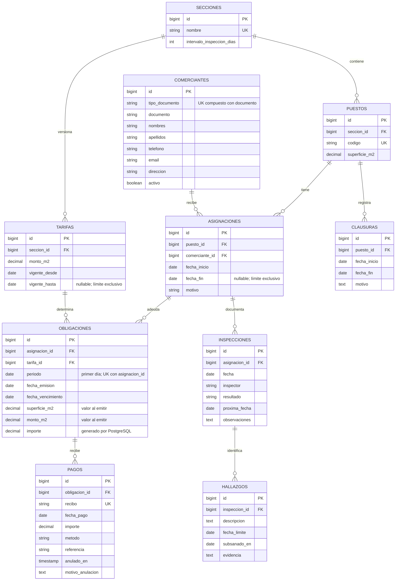

# Modelo entidad–relación

Cada línea representa uno a cero o muchos; cada hijo pertenece obligatoriamente a un padre. En el tiempo, puestos y comerciantes forman una relación muchos a muchos resuelta por asignaciones. Un puesto admite como máximo una asignación vigente por fecha. Cada tabla tiene timestamps técnicos, omitidos en el diagrama.

El diccionario físico completo, con longitudes, índices, nulabilidad y restricciones, está en `database/schema/mercado.sql`.

## Decisiones de negocio

- Un solo mercado; no se necesita una tabla con un único mercado ni un límite artificial de 300 puestos.
- Secciones iniciales: carnes, verduras, abarrotes y comida. Tarifa por sección y vigencia; moneda única BOB, propuesta pendiente de confirmación.
- Comerciante es titular de uso/alquiler, no propietario del inmueble municipal.
- Períodos `[inicio, fin)`: una transferencia el 15 cierra la asignación anterior el 15 y abre otra ese día. Ambas operaciones deben ejecutarse juntas en una transacción; no se cambia el comerciante de la asignación anterior.
- Mensualidad completa a cargo del titular del primer día del mes; sin prorrateo. Tarifa vigente ese día. Una transferencia a mitad de mes no crea otra mensualidad. Si se necesita cobrar altas a mitad de mes, habrá que acordar el prorrateo antes de implementar la emisión.
- `importe = round(superficie_m2 × monto_m2, 2)`. Los valores de emisión son hechos históricos, no duplicados del estado actual: no se recalculan al cambiar tarifas. La base los copia; el cliente no los envía.
- Pagos parciales: varios recibos por obligación; un recibo se aplica a una sola obligación. Sin anticipos ni pagos por encima del saldo. Las anulaciones conservan el recibo. No hay multas ni intereses definidos.
- Mora: `fecha_vencimiento < CURRENT_DATE AND saldo > 0` en la vista `saldos_obligaciones`. No se almacena un booleano que pueda desactualizarse.
- Estado del puesto derivado: clausurado si existe clausura vigente; en otro caso ocupado si hay asignación vigente; libre en los demás casos. La clausura conserva la titularidad y, por ahora, no exime de alquiler.
- Inspecciones asociadas a la asignación para identificar al responsable de ese momento. La última del puesto se busca entre todas sus asignaciones por fecha e ID. La transferencia no reinicia su historial sanitario.
- Próxima inspección: fecha explícita, normalmente fecha de visita más el intervalo de la sección. Se almacena porque puede adelantarse según los hallazgos y no debe cambiar al editar el intervalo recomendado. Una inspección no clausura automáticamente el puesto.
- Inspector registrado por nombre; no se diseña un módulo de personal ni autenticación en esta sesión.

## Normalización e integridad

Catálogos, titulares, eventos y documentos separados; las entidades tienen claves primarias simples y claves naturales únicas cuando corresponde. Las referencias históricas usan RESTRICT y no hay borrado en cascada ni borrado lógico indiscriminado. Las tarifas se versionan; obligaciones e inspecciones son inmutables. Sección y superficie del puesto quedan fijas al tener asignaciones; remodelaciones requieren un diseño posterior de versiones físicas.

PostgreSQL impide intervalos superpuestos mediante EXCLUDE, valida importes y fechas con CHECK y protege operaciones históricas con triggers. El bloqueo de la obligación serializa pagos concurrentes. Usar transacciones cortas y el aislamiento predeterminado READ COMMITTED; reintentar ante deadlocks. Los Requests mejoran los errores de entrada, pero no sustituyen restricciones ni transacciones.

Los Requests `Save*` usan la representación completa (POST/PUT), no PATCH. Para ediciones admitidas, los parámetros de ruta deben usar model binding (`puesto`, `comerciante`, `seccion`, `tarifa`, `asignacion`, `clausura`). Los registros históricos no tienen una operación genérica de edición: los triggers sólo permiten los cambios documentados. Antes de publicar endpoints, separar acciones de cierre/anulación y conectar políticas de autorización. El Request base exige usuario autenticado; no representa un sistema de permisos terminado.
