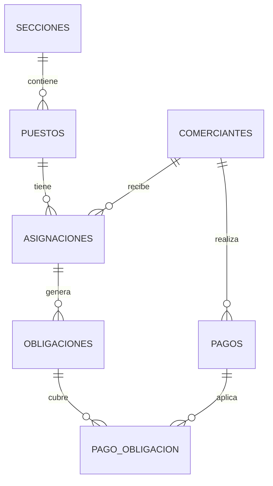

# Modelo de datos

PostgreSQL, 10 tablas. Todas tienen `id` bigint autoincremental, `created_at` y `updated_at`.

## Diccionario de datos

### secciones
| Columna | Tipo | Notas |
|---|---|---|
| nombre | varchar(80) | Único |
| tarifa_m2 | numeric(8,2) | Tarifa mensual por metro cuadrado |

### puestos
| Columna | Tipo | Notas |
|---|---|---|
| seccion_id | bigint | FK a `secciones` |
| codigo | varchar(30) | Único, formato `[A-Z0-9-]+` (por ejemplo `CAR-001`) |
| superficie_m2 | numeric(8,2) | Mayor que 0 |
| estado | varchar(20) | `libre` (por defecto), `ocupado`, `clausurado` |

### comerciantes
| Columna | Tipo | Notas |
|---|---|---|
| documento | varchar(30) | Único |
| nombres, apellidos | varchar(100) | |
| rubro | varchar(80) | |
| telefono | varchar(25) | |
| email | varchar(255) | Opcional |
| direccion | varchar(255) | |
| activo | boolean | Por defecto `true`. Solo los activos reciben asignaciones |

### asignaciones
| Columna | Tipo | Notas |
|---|---|---|
| puesto_id | bigint | FK a `puestos` |
| comerciante_id | bigint | FK a `comerciantes` |
| fecha_inicio | date | |
| fecha_fin | date | Nula = asignación vigente |
| motivo | varchar(255) | |

### obligaciones
| Columna | Tipo | Notas |
|---|---|---|
| asignacion_id | bigint | FK a `asignaciones` |
| periodo | date | Primer día del mes facturado |
| fecha_vencimiento | date | |
| superficie_m2, tarifa_m2 | numeric(8,2) | Copia de los valores al emitir |
| importe | numeric(10,2) | `superficie_m2 × tarifa_m2`, no se recalcula |
| estado | varchar(20) | `pendiente` (por defecto) o `pagada` |

Único: `(asignacion_id, periodo)`.

### pagos
| Columna | Tipo | Notas |
|---|---|---|
| comerciante_id | bigint | FK a `comerciantes` |
| comprobante | varchar(50) | Único, formato `MR-00001` |
| fecha_pago | date | |
| metodo | varchar(20) | `efectivo` o `transferencia` |
| total | numeric(10,2) | Suma de los importes de las obligaciones pagadas |

### pago_obligacion
| Columna | Tipo | Notas |
|---|---|---|
| pago_id | bigint | FK a `pagos` |
| obligacion_id | bigint | FK a `obligaciones` |
| monto | numeric(10,2) | Igual al importe de la obligación (pagos completos) |

Único: `(pago_id, obligacion_id)`.

### users
| Columna | Tipo | Notas |
|---|---|---|
| name | varchar(255) | Nombre visible en la barra superior |
| email | varchar(255) | Único; se usa para iniciar sesión |
| email_verified_at | timestamp | Nulo |
| password | varchar(255) | Hash de la contraseña |
| remember_token | varchar(100) | Nulo |
| rol | varchar(20) | `admin` o `cobrador`; por defecto `cobrador` |

### datos_mercado
| Columna | Tipo | Notas |
|---|---|---|
| nombre | varchar(120) | Nombre del mercado |
| eslogan | varchar(180) | Opcional |
| historia | text | Párrafos separados por una línea en blanco |
| direccion | varchar(255) | Dirección ficticia de La Paz |
| referencia | varchar(255) | Opcional |
| latitud, longitud | decimal(10,7) | Coordenadas referenciales para el mapa |
| horario_atencion | varchar(180) | |
| telefono | varchar(30) | |
| email | varchar(255) | Opcional |

La aplicación mantiene una sola fila; el formulario de administración actualiza esa ficha.

### fotos_mercado
| Columna | Tipo | Notas |
|---|---|---|
| titulo | varchar(120) | |
| descripcion | varchar(255) | Opcional |
| ruta | varchar(255) | `img/mercado/...` para relleno o `mercado/...` para subidas |
| orden | integer | Por defecto 0; menor primero |

El accesorio `url` devuelve `asset(ruta)` para las imágenes de relleno y `asset('storage/' . ruta)` para las subidas.

## Integridad referencial

- Todas las claves foráneas usan `ON UPDATE CASCADE` y `ON DELETE RESTRICT`, salvo `pago_obligacion.pago_id`, que usa `ON DELETE CASCADE`.
- Los valores permitidos de `estado` y `metodo` (columnas de texto), el solapamiento de asignaciones y el cálculo de importes se garantizan en la aplicación (Form Requests, controladores y transacciones).

## Relaciones Eloquent

| Modelo | Relaciones |
|---|---|
| Seccion | `puestos()` |
| Puesto | `seccion()`, `asignaciones()` |
| Comerciante | `asignaciones()`, `pagos()` |
| Asignacion | `puesto()`, `comerciante()`, `obligaciones()` |
| Obligacion | `asignacion()`, `pagos()` |
| Pago | `comerciante()`, `obligaciones()` |
| Puesto | Además `asignacionVigente()` (asignación sin fecha de fin) |
| User | Sin relaciones; expone constantes `ROL_ADMIN`, `ROL_COBRADOR` y `tieneRol(...)` |
| DatoMercado | Sin relaciones (una sola fila) |
| FotoMercado | Sin relaciones; accesorio `url` y ayuda `esDeRelleno()` |
